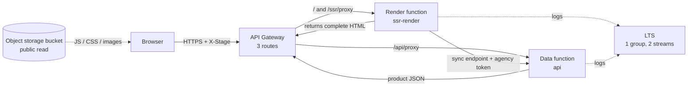

# React Server-Side Rendering on FunctionGraph and Object Storage

[](LICENSE)
[](https://www.huaweicloud.com)

Two serverless functions carry first-screen rendering and the data API, while static assets are
served directly from an object storage bucket. The page is rendered to complete HTML on the server
before it reaches the browser, and the client only hydrates. It suits front-end teams that need
first-screen visibility and search-friendly markup without operating a long-running Node process.

## Overview

The first-screen problem of a single-page app is concrete: the browser receives an empty shell, then
waits for scripts to download, execute, and issue another data request before the user sees content.
Server-side rendering moves that wait onto the server — but where and how it moves determines the
complexity:

- **Rendering on the server** — the render function fetches product data, runs `renderToString`, and
  injects hydration data, returning complete HTML in one response. The user sees a first screen that
  already contains the content.
- **Data over the internal network** — the render function reaches the data function through the
  function synchronous invocation endpoint, exchanging its agency for a temporary token. It neither
  loops through the public gateway nor holds a long-lived secret.
- **Static assets from the bucket** — build output is content-hashed and uploaded to a public-read
  bucket; the page links to it directly. Content changes rename the object, so objects can be cached
  for a long time.
- **Page and API share an origin** — the client uses relative paths, and build output carries no
  environment address.

**What it solves**: it turns "first screen produced on the server, client only hydrates" into a
deployable and verifiable minimum loop.

**Who it is for**: content sites, product listing pages and campaign landing pages that need
first-screen and crawlability guarantees, and teams that want serverless rendering without
maintaining processes and caches themselves.

## Table of Contents

- [Architecture](#architecture)
- [Highlights](#highlights)
- [Cloud Services](#cloud-services)
- [Prerequisites](#prerequisites)
- [Quick Start](#quick-start)
- [Step-by-step Deployment](#step-by-step-deployment)
- [Usage and Verification](#usage-and-verification)
- [Repository Layout](#repository-layout)
- [Clean Up](#clean-up)
- [Further Reading](#further-reading)
- [FAQ](#faq)
- [License](#license)
- [Contact](#contact)

## Architecture



The render function does the fetching and rendering on the server; the browser only downloads assets
and hydrates.

| Layer | Service | Description |
|-|-|-|
| Ingress | API Gateway dedicated instance | Group + environment + 3 APIs + publications, function backend, synchronous invocation |
| Rendering | FunctionGraph (Node.js 18) | First-screen rendering and hydration data, ZIP package |
| Data | FunctionGraph (Node.js 18) | Product JSON API, single-file inline |
| Static assets | Object Storage Service | Public-read bucket, content-hashed build output |
| Observability | LTS | One log group with two streams |
| Permissions | IAM | Custom policy plus agency, granting only the target function invocation action |

## Highlights

- **First screen is verifiable** — content is present in the returned HTML; with scripts disabled
  the products are still visible, rather than appearing only after client execution.
- **Fetching avoids the public gateway** — the render function calls the function synchronous
  endpoint, lowering tail latency and keeping the origin off the public path.
- **Assets cache for a long time** — filenames carry a content digest, so a change renames the
  object and no on-path invalidation is needed.
- **Deterministic artifacts** — the server bundle is zipped with pinned entry timestamps, so
  rebuilds of the same source produce the same digest.
- **All configuration supplied at runtime** — asset prefix, region, project identifier and target
  function are all supplied at runtime; build output carries no environment address.
- **Four log parameters bound** — the group and streams are created explicitly and both IDs and
  names are bound, so logs are never silently dropped.

## Cloud Services

| Service | Role in this sample | Terraform resource |
|-|-|-|
| FunctionGraph | Render function and data function | `huaweicloud_fgs_function` |
| API Gateway | Group, environment, three APIs and publications | `huaweicloud_apig_group`, `huaweicloud_apig_environment`, `huaweicloud_apig_api`, `huaweicloud_apig_api_publishment` |
| Object Storage Service | Static asset bucket and object uploads | `huaweicloud_obs_bucket`, `huaweicloud_obs_bucket_object` |
| LTS | One log group and two log streams | `huaweicloud_lts_group`, `huaweicloud_lts_stream` |
| IAM | Custom policy and agency | `huaweicloud_identity_role`, `huaweicloud_identity_agency` |

Release these resources when the sample is no longer needed, to avoid leaving them behind.

## Prerequisites

**Account and permissions**

- An account that has completed real-name verification, with `cn-north-4` available (this sample
  was verified there).
- Permission to enable and operate FunctionGraph, API Gateway, Object Storage and LTS.
- Access Key ID and Secret Access Key from the "My Credentials" page, supplied to the deployment
  shell. Never write credentials into code or commit them.

**External resources already in place**

- An API Gateway dedicated instance and its instance ID.

**Tools and versions**

- Terraform CLI `>= 1.5`, huaweicloud provider `~> 1.95`.
- Node.js 18 or later for the front-end and server bundling, Python 3.9 or later for the build
  scripts.

**Region and naming constraints**

- `var.app_name` feeds the bucket name and object keys: it must start with a lowercase letter, may
  contain digits and hyphens, and is 2 to 15 characters long.
- The bucket name is "prefix + random suffix"; read the actual value from
  `terraform output static_bucket`.
- The environment name must match the `X-Stage` header value. A non-RELEASE environment without
  that header returns 404.

## Quick Start

```bash
# 1. Build the front end and the server package
python src/scripts/build.py

# 2. Local render smoke test and static checks
node src/test/smoke_ssr.js
cd infra && terraform init && terraform validate && cd ..

# 3. Supply deployment values and create resources
cd infra
export HW_ACCESS_KEY=<HW_ACCESS_KEY>
export HW_SECRET_KEY=<HW_SECRET_KEY>
export TF_VAR_apig_instance_id="<API Gateway dedicated instance ID>"
terraform plan -out=rsw.tfplan
terraform apply rsw.tfplan

# 4. Verify
cd ..
python src/scripts/verify_e2e.py
```

## Step-by-step Deployment

### Step 1: Build

```bash
python src/scripts/build.py
```

Expected output:

```text
[build] $ npm install --no-audit --no-fund
[build] $ npm run build
[build] assets manifest -> .../src/frontend/src/build-assets.json: {"js": ["static/js/main.<hash>.js"], "css": []}
[build] server bundle size: 87121 bytes
[build] zip -> .../src/dist/functions/ssr-render.zip (27995 bytes)
[build] done
```

The first build installs front-end dependencies and takes longer; later builds reuse them.

### Step 2: Local checks

```bash
node src/test/smoke_ssr.js
```

The script builds an event locally, calls the render entry and verifies the HTML contains the root
node and the hydration data. It makes no cloud calls.

```bash
cd infra
terraform init
terraform validate
```

Expected output:

```text
Success! The configuration is valid, but there were some
validation warnings as shown above.
```

### Step 3: Supply deployment values

One value is required:

```bash
export TF_VAR_apig_instance_id="<API Gateway dedicated instance ID>"
```

Optional values (the full list is in `infra/variables.tf`):

| Variable | Default | Description |
|-|-|-|
| `region` | `cn-north-4` | Deployment region |
| `app_name` | `rsw` | Resource name prefix (lowercase, 2 to 15 characters) |
| `environment_name` | `prod` | Publication environment (used only when the sample creates its own) |
| `shared_apig_env_id` | empty | Existing shared environment; when set, no environment is created |

### Step 4: Create resources

```bash
cd infra
terraform plan -out=rsw.tfplan
terraform apply rsw.tfplan
```

Expected output (object uploads vary with front-end artifacts; the count below excludes them):

```text
Plan: 15 to add, 0 to change, 0 to destroy.
Apply complete! Resources: N added, 0 changed, 0 destroyed.
```

### Step 5: Read the outputs

```bash
terraform output
```

Common values:

```bash
terraform output ssr_page_url      # page entry
terraform output api_products_url  # product API address
terraform output static_base_url   # static asset prefix
```

## Usage and Verification

### Minimal example: fetch the first screen

```bash
export BASE="$(terraform output -raw page_base_url)"

curl -s "$BASE/" -H "X-Stage: prod" | head -20
```

Expected HTML containing the root node placeholder and the hydration data script:

```html
<div id="root">…</div>
<script>window.__INITIAL_DATA__ = {…}</script>
```

### Verify server-side rendering really happens

Look for product content directly in the returned HTML:

```bash
curl -s "$BASE/" -H "X-Stage: prod" | grep -o "<product name>" | head -3
```

A direct hit means the first screen was rendered on the server, not produced after client script
execution.

### Run all six checks at once

```bash
python src/scripts/verify_e2e.py
```

Expected output:

```json
{"passed": true, "checks": 6}
```

The six checks cover: the first screen returns `text/html`, asset URLs point at the object storage
bucket, the `/ssr/{proxy}` route works, the product API returns five records, a static asset direct
link is reachable, and a request without `X-Stage` returns 404.

### Verify static asset direct links

```bash
export ASSETS="$(terraform output -raw static_base_url)"
curl -sI "$ASSETS/static/js/main.<hash>.js" | head -3
```

Expected 200. Asset names carry the content digest, so changed content yields a new digest.

**After deployment, run the steps in this section in your own environment and confirm the features
work before treating the delivery as complete.**

## Repository Layout

```text
.
├── README.md
├── README.en.md
├── LICENSE
├── docs/
│   ├── architecture.md          Render path, data flow and trade-offs
│   └── deployment-guide.md      Step-by-step commands with expected output
├── infra/
│   ├── versions.tf              Terraform and provider version constraints
│   ├── variables.tf             Input variables
│   ├── main.tf                  Logs, permissions, two functions, static bucket, gateway
│   └── outputs.tf               Outputs
└── src/
    ├── frontend/                React app and server render entry
    ├── functions/api/index.js   Product data API
    ├── scripts/build.py         Front-end build and server packaging
    ├── scripts/verify_e2e.py    Post-deployment verification
    ├── test/smoke_ssr.js        Local render smoke test
    └── dist/                    Build artifacts (generated)
```

## Clean Up

```bash
cd infra
terraform destroy
```

Expected output:

```text
Destroy complete! Resources: N destroyed.
```

Destroy removes both functions, the group/environment/APIs/publications, the log group and streams,
the agency and custom policy, and the bucket with all its objects. The API Gateway dedicated
instance is external and outside this directory's cleanup scope.

## Further Reading

- Render path, end-to-end data flow and trade-offs: [docs/architecture.md](docs/architecture.md)
- Complete commands from zero to a verified deployment: [docs/deployment-guide.md](docs/deployment-guide.md)
- Chinese edition: [README.md](README.md)

## FAQ

**The page returns 404.**
First check for the `X-Stage` header, then confirm all three APIs are published to the target
environment.

**The page returns 200 but renders blank.**
Check whether the HTML contains the root node and hydration data; inspect the render function logs
for the fetch and render steps.

**An asset returns 404.**
Confirm the object was uploaded to `static_bucket` and that `static_base_url` matches the actual
bucket domain.

**The render function reports a fetch failure.**
Check whether the agency is bound to the custom policy, and whether the resource path in the policy
matches the data function name exactly.

**The first request is slow.**
Function cold start. Retry; if it stays slow, check the render function memory and timeout settings.

**Logs are empty.**
Both functions must bind all four log parameters: group ID, group name, stream ID and stream name.

## License

This sample is released under the MIT No Attribution license. See [LICENSE](LICENSE).

## Contact

Created and maintained by: Public Cloud Continuous Operations Department.

Please open an issue in this repository if you run into problems; we review them regularly.
