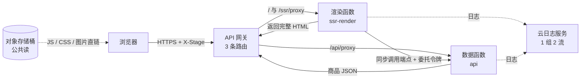

# 基于函数计算与对象存储的 React 服务端渲染实践

[](LICENSE)
[](https://www.huaweicloud.com)

用两个无服务器函数分别承担首屏渲染与数据接口，静态资产放在对象存储桶中直链访问。
页面在服务端渲染成完整 HTML 后才返回浏览器，客户端只做 hydrate。
适用于需要首屏可见性、SEO 友好、又不愿维护常驻 Node 进程的前端团队。

## 简介

单页应用的首屏问题很具体：浏览器拿到空壳后要等脚本下载、执行、再发一次数据请求，
用户才看到内容。服务端渲染把这段等待搬到服务器上——但搬到哪、怎么搬，决定了复杂度：

- **渲染在服务端**：渲染函数在服务端拉取商品数据、执行 `renderToString`、注入 hydration 数据，
  一次返回完整 HTML。用户看到首屏时内容已经在了。
- **取数走内网**：渲染函数经函数同步调用端点访问数据函数，以委托换取临时令牌，
  不绕公网网关，也不持有长期密钥。
- **静态资产走桶**：构建产物按内容哈希命名后上传到公共读的对象存储桶，页面直链引用。
  内容变则文件名变，因此可以长期缓存。
- **页面与接口同域**：客户端用相对路径请求接口，构建产物不含环境地址。

**解决的问题**：把「首屏在服务端产出、客户端只做 hydrate」这条链路做成一次可部署的最小闭环。

**适用于**：内容型站点、商品列表页、营销落地页等对首屏与抓取有要求的场景；
想用无服务器形态承载渲染、又不想自己维护进程与缓存的团队。

## 目录

- [架构图](#架构图)
- [方案亮点](#方案亮点)
- [涉及云服务](#涉及云服务)
- [前置条件](#前置条件)
- [快速开始](#快速开始)
- [分步部署](#分步部署)
- [使用方法与验证](#使用方法与验证)
- [仓库结构](#仓库结构)
- [清理资源](#清理资源)
- [详细说明](#详细说明)
- [常见问题](#常见问题)
- [许可证](#许可证)
- [联系方式](#联系方式)

## 架构图



渲染函数在服务端完成取数与渲染，浏览器只需下载资产并 hydrate；资产与页面同源策略下分属两条路径。

| 层次 | 承担的服务 | 说明 |
|-|-|-|
| 入口 | API 网关专享实例 | 分组 + 环境 + 3 条 API + 发布，函数后端、同步调用 |
| 渲染 | 函数计算（Node.js 18） | 首屏渲染与 hydration 数据注入，ZIP 部署包 |
| 数据 | 函数计算（Node.js 18） | 商品 JSON 接口，单文件内联 |
| 静态资产 | 对象存储服务 | 公共读桶，构建产物按内容哈希命名 |
| 观测 | 云日志服务 | 一个日志组与两条日志流 |
| 权限 | 统一身份认证 | 自定义策略 + 委托，仅授予目标函数调用动作 |

## 方案亮点

- **首屏可真验证**：HTML 返回时内容已在其中，关闭脚本也能看到商品——不是「等客户端跑完才出现」。
- **取数不绕公网**：渲染函数调用函数同步调用端点，尾延迟更低，源站不暴露在公网路径上。
- **资产可长期缓存**：文件名带内容摘要，内容变即名变，无需在访问路径上做失效。
- **构建产物确定性**：服务端 bundle 以固定条目时间戳打 zip，重复构建摘要一致。
- **配置全部运行期下发**：资产前缀、区域、项目标识与目标函数都在运行期下发，构建产物不含环境地址。
- **日志四参数绑定**：显式建组建流并绑定 ID 与名称，避免日志静默丢失。

## 涉及云服务

| 云服务 | 本实践中的职责 | 对应 Terraform 资源 |
|-|-|-|
| 函数计算 | 渲染函数与数据函数 | `huaweicloud_fgs_function` |
| API 网关 | 分组、环境、三条 API 与发布 | `huaweicloud_apig_group`、`huaweicloud_apig_environment`、`huaweicloud_apig_api`、`huaweicloud_apig_api_publishment` |
| 对象存储服务 | 静态资产桶与对象上传 | `huaweicloud_obs_bucket`、`huaweicloud_obs_bucket_object` |
| 云日志服务 | 一个日志组与两条日志流 | `huaweicloud_lts_group`、`huaweicloud_lts_stream` |
| 统一身份认证服务 | 自定义策略与委托 | `huaweicloud_identity_role`、`huaweicloud_identity_agency` |

确认不再需要本实践后，及时释放上述资源，避免残留。

## 前置条件

**账号与权限**

- 已开通账号并完成实名认证，可用区域为 `cn-north-4`（本实践在该区域验证）。
- 具备函数计算、API 网关、对象存储与云日志服务的开通与操作权限。
- 在「我的凭证」页面获取 Access Key ID 与 Secret Access Key，填入部署脚本；
  不要把凭据写入代码或提交到仓库。

**已就绪的外部资源**

- 一个 API 网关专享实例，记录其实例 ID。

**工具与版本**

- Terraform CLI `>= 1.5`，huaweicloud Provider `~> 1.95`。
- Node.js 18 及以上（前端与服务端打包），Python 3.9 及以上（构建脚本）。

**区域与命名约束**

- `var.app_name` 会进入桶名与对象键，须小写字母开头、可含数字与连字符、长度 2~15。
- 桶名为「前缀 + 随机后缀」，部署后以 `terraform output static_bucket` 为准。
- 环境名与请求头 `X-Stage` 的取值必须一致；非 RELEASE 环境不带该请求头会返回 404。

## 快速开始

```bash
# 1. 构建前端与服务端部署包
python src/scripts/build.py

# 2. 本地渲染冒烟与静态校验
node src/test/smoke_ssr.js
cd infra && terraform init && terraform validate && cd ..

# 3. 填写部署参数并创建资源
cd infra
export HW_ACCESS_KEY=<HW_ACCESS_KEY>
export HW_SECRET_KEY=<HW_SECRET_KEY>
export TF_VAR_apig_instance_id="<APIG 专享实例 ID>"
terraform plan -out=rsw.tfplan
terraform apply rsw.tfplan

# 4. 验证
cd ..
python src/scripts/verify_e2e.py
```

## 分步部署

### 第 1 步：构建

```bash
python src/scripts/build.py
```

预期输出：

```text
[build] $ npm install --no-audit --no-fund
[build] $ npm run build
[build] assets manifest -> .../src/frontend/src/build-assets.json: {"js": ["static/js/main.<哈希>.js"], "css": []}
[build] server bundle size: 87121 bytes
[build] zip -> .../src/dist/functions/ssr-render.zip (27995 bytes)
[build] done
```

首次构建会安装前端依赖，耗时较长；后续构建复用已安装的依赖。

### 第 2 步：本地校验

```bash
node src/test/smoke_ssr.js
```

脚本在本地构造事件调用渲染入口，校验 HTML 含根节点与 hydration 数据，不访问云端。

```bash
cd infra
terraform init
terraform validate
```

预期输出：

```text
Success! The configuration is valid, but there were some
validation warnings as shown above.
```

### 第 3 步：填写部署参数

必填一项：

```bash
export TF_VAR_apig_instance_id="<APIG 专享实例 ID>"
```

可选参数（完整清单见 `infra/variables.tf`）：

| 变量 | 默认值 | 说明 |
|-|-|-|
| `region` | `cn-north-4` | 部署区域 |
| `app_name` | `rsw` | 资源名称前缀（小写，长度 2~15） |
| `environment_name` | `prod` | 发布环境名（仅自建环境时生效） |
| `shared_apig_env_id` | 空 | 已有共享环境 ID；非空时不创建环境 |

### 第 4 步：创建资源

```bash
cd infra
terraform plan -out=rsw.tfplan
terraform apply rsw.tfplan
```

预期输出（对象上传数量随前端产物浮动，以下数字不含对象上传）：

```text
Plan: 15 to add, 0 to change, 0 to destroy.
Apply complete! Resources: N added, 0 changed, 0 destroyed.
```

### 第 5 步：查看部署输出

```bash
terraform output
```

常用取值：

```bash
terraform output ssr_page_url      # 页面入口
terraform output api_products_url  # 商品接口地址
terraform output static_base_url   # 静态资产前缀
```

## 使用方法与验证

### 最简示例：取一次首屏

```bash
export BASE="$(terraform output -raw page_base_url)"

curl -s "$BASE/" -H "X-Stage: prod" | head -20
```

预期返回 HTML，包含根节点占位与 hydration 数据脚本：

```html
<div id="root">…</div>
<script>window.__INITIAL_DATA__ = {…}</script>
```

### 验证服务端渲染确实生效

在返回的 HTML 中直接查找商品内容：

```bash
curl -s "$BASE/" -H "X-Stage: prod" | grep -o "<商品名>" | head -3
```

能直接命中说明首屏已在服务端渲染完成，而不是等客户端脚本执行后才出现。

### 一次跑完六项校验

```bash
python src/scripts/verify_e2e.py
```

预期输出：

```json
{"passed": true, "checks": 6}
```

六项覆盖：首屏返回 `text/html`、页面引用的资产地址指向对象存储桶、
`/ssr/{proxy}` 路由可用、商品接口返回五条记录、静态资产直链可访问、
缺少 `X-Stage` 时返回 404。

### 验证静态资产直链

```bash
export ASSETS="$(terraform output -raw static_base_url)"
curl -sI "$ASSETS/static/js/main.<哈希>.js" | head -3
```

预期返回 200。资产名带内容摘要，内容变化后新文件名为新摘要。

**部署完成后请按本节步骤在真实环境自行验证，确认功能可用后方可视为交付完成。**

## 仓库结构

```text
.
├── README.md
├── README.en.md
├── LICENSE
├── docs/
│   ├── architecture.md          渲染链路、数据流与关键设计取舍
│   └── deployment-guide.md      分步部署命令与每步预期输出
├── infra/
│   ├── versions.tf              Terraform 与 Provider 版本约束
│   ├── variables.tf             输入变量
│   ├── main.tf                  日志、权限、两个函数、静态桶、网关
│   └── outputs.tf               对外输出
└── src/
    ├── frontend/                React 应用与服务端渲染入口
    ├── functions/api/index.js   商品数据接口
    ├── scripts/build.py         前端构建与服务端打包
    ├── scripts/verify_e2e.py    部署后校验
    ├── test/smoke_ssr.js        本地渲染冒烟
    └── dist/                    构建产物（构建生成）
```

## 清理资源

```bash
cd infra
terraform destroy
```

预期输出：

```text
Destroy complete! Resources: N destroyed.
```

销毁会删除两个函数、分组/环境/API/发布、日志组与日志流、委托与自定义策略，
以及对象存储桶与桶内全部对象。网关专享实例属外部资源，不在本目录的清理范围。

## 详细说明

- 渲染链路、端到端数据流与关键设计取舍：[docs/architecture.md](docs/architecture.md)
- 从零到可验证部署的完整命令与预期输出：[docs/deployment-guide.md](docs/deployment-guide.md)
- 英文版说明：[README.en.md](README.en.md)

## 常见问题

**页面返回 404。**
先确认是否遗漏 `X-Stage` 请求头；再确认三条路由是否都已发布到目标环境。

**页面返回 200 但白屏。**
检查 HTML 是否含根节点与 hydration 数据；查看渲染函数日志确认取数与渲染步骤。

**资产 404。**
确认对象已上传到 `static_bucket`；`static_base_url` 是否与实际桶域名一致。

**渲染函数报取数失败。**
委托是否绑定了自定义策略；策略里的函数资源路径是否与数据函数名完全一致。

**首次请求很慢。**
函数冷启动所致，重试即可。持续偏慢检查渲染函数的内存与超时配置。

**日志为空。**
两个函数必须同时绑定日志组 ID / 名称与日志流 ID / 名称四个参数。

## 许可证

本实践采用 MIT No Attribution 许可证发布，详见 [LICENSE](LICENSE)。

## 联系方式

创建与维护团队：公有云持续运营部。

使用中遇到问题请在本仓库提交议题，我们会定期查看。
