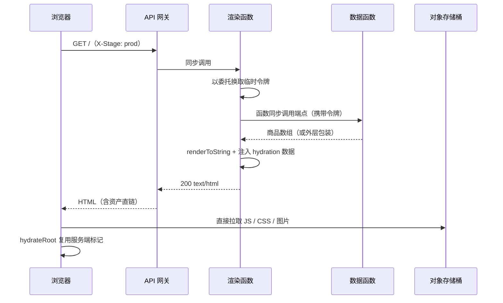
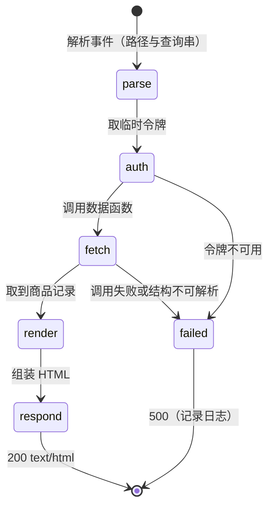

# 架构与技术设计

本文说明本实践的服务端渲染架构、端到端数据流与关键设计取舍。
部署命令见 [deployment-guide.md](deployment-guide.md)，功能概览见仓库根目录 `README.md`。

## 1. 分层与职责

| 层 | 职责 | 落地位置 |
|-|-|-|
| 入口层 | 页面路由与接口路由，统一在同一分组下发布 | `infra/main.tf` 的分组、环境、3 条 API 与发布记录 |
| 渲染层 | 首屏渲染、hydration 数据注入、页面组装 | `src/frontend/src/server/index.js` |
| 数据接口层 | 返回商品记录 | `src/functions/api/index.js` |
| 静态资产层 | 承载构建产物，按内容哈希命名 | `infra/main.tf` 的对象存储桶与对象上传 |
| 观测层 | 两条运行日志流 | `infra/main.tf` 的日志组与日志流 |

## 2. 组件清单

### 2.1 两个函数（`infra/main.tf`）

| 组件 | 运行时 / 规格 | 部署形态 |
|-|-|-|
| `ssr-render` | Node.js 18.15 / 128 MB / 15 秒 | ZIP 部署包（webpack 服务端 bundle 打 zip） |
| `api` | Node.js 18.15 / 128 MB / 15 秒 | 单文件内联 |

渲染函数持有委托，用于调用数据函数；数据函数不持有委托。

### 2.2 路由（`infra/main.tf`）

| 方法 | 路径 | 后端 | 说明 |
|-|-|-|-|
| ANY | `/` | ssr-render | 首屏页面 |
| ANY | `/ssr/{proxy}` | ssr-render | 页面子路由，与首屏同一渲染入口 |
| ANY | `/api/{proxy}` | api | 商品 JSON 接口 |

三条路由均为同步调用、网关侧超时 15 秒、API 侧不设鉴权；非 RELEASE 环境由 `X-Stage` 指定。

### 2.3 静态资产

- 1 个公共读对象存储桶，桶名带随机后缀。
- 构建产物按内容哈希命名后逐个上传（排除 `index.html`，该页由渲染函数生成）。
- 对象 `Content-Type` 按扩展名映射（JS、CSS、JSON、PNG、ICO、SVG、TXT、HTML、webmanifest）。

### 2.4 观测与权限

- 1 个日志组与 2 条日志流，函数侧绑定四个参数。
- 1 个自定义策略，只授予目标函数的调用动作，资源路径为 `FunctionGraph:*:*:function:default/<数据函数名>`。
- 1 个委托，信任云服务身份，绑定上述策略。

## 3. 端到端数据流

### 3.1 一次页面请求的完整时序

渲染函数对数据函数返回结构的两种形态（直接数组、`{..., body}` 外层包装）都做兼容。

### 3.2 渲染函数的阶段状态机

### 3.3 首屏与 hydration

首屏数据在服务端一次性取齐并随 HTML 下发，客户端 hydrate 时直接消费，
因此页面可见与可交互之间没有额外的数据往返。

## 4. 运行期配置契约

渲染函数的运行期配置只取 `local.ssr_function_env` 中已声明的键。

| 键 | 来源 | 用途 |
|-|-|-|
| `REGION` | `var.region` | 调用函数端点时的区域 |
| `PROJECT_ID` | 账户数据源 | 调用路径中的项目标识 |
| `API_FUNCTION_URN` | 数据函数 URN（去掉版本后缀） | 调用目标 |
| `STATIC_BASE_URL` | 由桶名与区域拼成 | 页面中资产直链前缀 |

数据函数无运行期配置，商品记录内置于代码。

## 5. 关键设计取舍

### 5.1 为什么渲染函数不经过公网网关回调数据函数

渲染发生在服务端，若经公网网关回调自己的接口，请求要多走一次公网出口，
既增加尾延迟，也让源站暴露在公网路径上。改为调用函数同步调用端点后，
渲染与数据在同一网络内完成，且以委托换取临时令牌，不引入长期密钥。

### 5.2 为什么页面与接口同域

同域带来三件事：客户端可用相对路径请求接口，构建产物不含环境地址，
浏览器不会因跨域而受限。代价是页面与接口必须发布在同一分组与环境下，
这也是三条路由共用一次发布的原因。

### 5.3 为什么静态资产按内容哈希命名

构建产物文件名带内容摘要，内容变化即文件名变化，因此对象存储桶可以长期缓存这些对象，
不需要在访问路径上做缓存失效。`index.html` 由渲染函数动态生成，不进入桶内。

### 5.4 为什么渲染入口同时服务 `/` 与 `/ssr/{proxy}`

单页应用的前端路由需要在服务端兜底渲染，否则刷新子路由会 404。
把两个路径指向同一入口后，服务端对任意子路由都返回同一份首屏，
客户端接管后按实际路径渲染。

### 5.5 为什么边缘渲染不落地

边缘渲染依赖在内容分发网络的边缘节点上执行代码。本平台函数计算没有边缘节点执行形态，
强行为之只能退化成「多区域部署同一函数 + 就近解析」，反而引入一致性负担。
因此首屏渲染统一由区域内的渲染函数承担，静态资产走桶直链——
这两者已覆盖样例要展示的核心能力：首屏在服务端产出、客户端只做 hydrate。

### 5.6 为什么数据函数用内联代码

数据函数只有一个入口文件、无第三方依赖，内联部署省去打包与上传对象两步，
改代码后只需一次应用。渲染函数则不同：它由 webpack 打出的 bundle 体积较大且带外部依赖，
必须走 ZIP 部署包。

## 6. 扩展点

- **换商品数据源**：改 `src/functions/api/index.js` 的实现，渲染侧无需改动。
- **加页面路由**：在 `local.api_routes` 增加一项并指向渲染函数即可。
- **改为受控静态资产**：把桶改为私有并接入分发服务，同时调整 `static_base_url` 的注入值。
- **加缓存**：在渲染函数内对数据调用加短 TTL 缓存，桶内资产已是内容哈希命名，无需额外处理。
- **换运行时版本**：两个函数的 `runtime` 字段一并调整。
